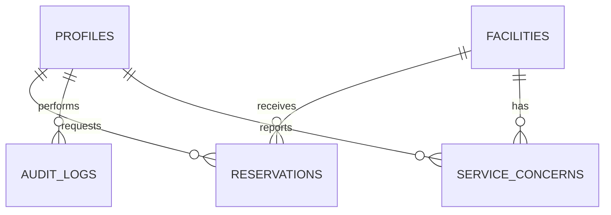

# Entity Relationship Diagram

## Entities
- **profiles**: id, full_name, email, role
- **facilities**: id, name, location, description, condition
- **reservations**: id, facility_id (FK), requester_id (FK), start_time, end_time, purpose, status, reviewed_by
- **audit_logs**: id, actor_id (FK), action, entity, entity_id, details, created_at
- **service_concerns**: id, facility_id (FK), reported_by (FK), description, status
